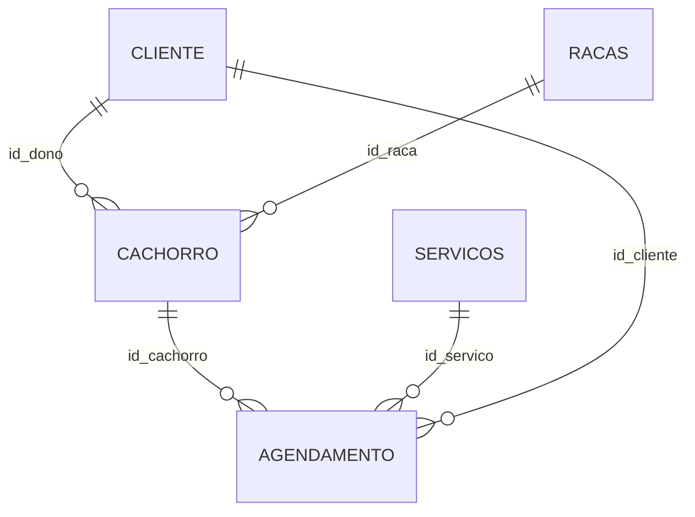
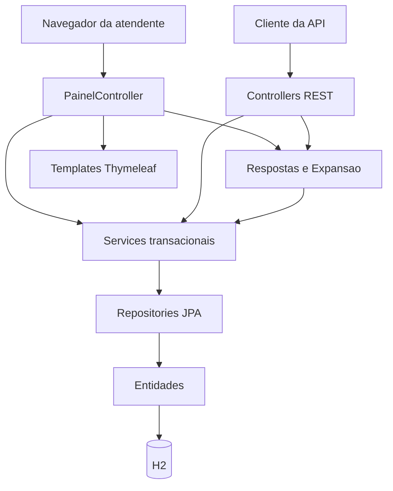

# Especificação do Sistema Cãobeleleiro

**Sistema:** agenda de banho e tosa (`agenda_banhoetosa`)  
**Identificação visual:** Cãobeleleiro  
**Plataforma:** aplicação web em Java 17, Spring Boot 4.1.1  
**Persistência:** JPA / Hibernate sobre banco H2 em arquivo (`./data/agenda`)  
**Interfaces:** painel Thymeleaf para a atendente e API REST JSON para os mesmos recursos

Este documento descreve o sistema a partir do código-fonte implementado: entidades, serviços, controladores, templates e configuração de persistência.

---

## Objetivo do Sistema

O Cãobeleleiro registra a operação diária de um estabelecimento de banho e tosa. O objetivo é manter, em um único cadastro, os tutores, os cães, as raças, o catálogo de serviços e os horários marcados, e apresentar esses horários em uma agenda mensal utilizável pela atendente.

O sistema oferece duas formas de acesso ao mesmo modelo de dados:

- um **painel web** autenticado, com calendário, formulários de cadastro e edição de agendamentos;
- uma **API REST** com operações de inclusão, consulta, alteração e exclusão sobre clientes, raças, cachorros, serviços e agendamentos.

A agenda calcula, a partir da duração do serviço, o intervalo ocupado por cada atendimento e associa o horário ao cão e ao tutor dono daquele cão.

---

## Benefícios esperados com a utilização

- **Agenda única do estabelecimento.** Os atendimentos deixam de depender de anotações soltas. Cada horário fica ligado a um cachorro, a um serviço e a um cliente.
- **Consulta visual do mês.** O calendário destaca o dia corrente, permite navegar entre meses, filtra o dia selecionado e mostra até três horários em cada célula, com indicação de excedente.
- **Cadastro reutilizável.** Cliente, raça e serviço são gravados uma vez e reaproveitados nos agendamentos seguintes. O catálogo inicial já traz raças e serviços comuns de banho e tosa.
- **Duração explícita do serviço.** Banho, tosa e banho com tosa carregam o tempo em minutos. A listagem da agenda exibe o horário de início e o horário de término estimado.
- **Duas interfaces sobre a mesma regra de negócio.** O painel atende o balcão. A API permite integrar outro cliente (aplicativo, planilha ou script) sem duplicar o cadastro.
- **Integridade referencial.** Cachorro exige dono e raça. Agendamento exige cachorro, serviço, cliente e data. A exclusão de um registro ainda referenciado é recusada.
- **Respostas da API sob demanda.** A consulta devolve identificadores por padrão e só inclui objetos relacionados quando o cliente pede a expansão, o que reduz o volume trafegado e evita a serialização de grafos preguiçosos do Hibernate.

---

## Problema a Ser Resolvido

Um pet shop de banho e tosa precisa saber, para cada horário, qual cão será atendido, de quem ele é, qual serviço foi contratado e quanto tempo aquele serviço ocupa. Sem um cadastro integrado, essas informações se dispersam: o nome do tutor fica em um caderno, a raça em outro, e o horário em uma agenda que não conhece a duração do serviço.

O problema concreto tratado pelo sistema é organizar quatro conjuntos de informação e o vínculo entre eles:

| Informação | O que precisa ser conhecido |
| --- | --- |
| Cliente (tutor) | Nome completo, telefone e endereço |
| Cachorro | Nome, tutor e raça |
| Serviço | Descrição e duração em minutos |
| Agendamento | Data e hora, cachorro atendido, serviço contratado e cliente responsável |

O painel precisa ainda restringir o acesso da atendente por sessão, montar o calendário do mês em português e impedir o agendamento quando ainda não existe cachorro ou serviço cadastrado.

---

## Principais dificuldades enfrentadas

As dificuldades abaixo aparecem no desenho do código e nas decisões de configuração.

### Modelo com vários relacionamentos obrigatórios

Um agendamento aponta ao mesmo tempo para cachorro, serviço e cliente. O cachorro, por sua vez, aponta para o tutor e para a raça. Na inclusão pelo painel, o cliente do agendamento é o dono do cachorro escolhido, de modo que o horário não fique associado a um tutor diferente do proprietário do animal. Na API, os três identificadores são informados no corpo da requisição e resolvidos para entidades persistidas antes da gravação. Identificador ausente produz resposta `400`. Identificador inexistente produz `404`.

### Serialização de associações preguiçosas

As relações `@ManyToOne` usam `FetchType.LAZY`. Devolver a entidade JPA diretamente em uma listagem JSON arrastaria proxies do Hibernate e poderia disparar cargas em cascata ou falhas fora da sessão. A API de consulta responde com records (`ClienteResposta`, `CachorroResposta`, `RacaResposta`, `ServicoResposta`, `AgendamentoResposta`). Campos de objeto relacionado só entram no JSON quando o parâmetro `expand` os solicita. Campos nulos são omitidos (`JsonInclude.NON_NULL`).

### Expansão aninhada controlada

Cada recurso declara o conjunto de expansões permitidas. Um nome fora dessa lista gera `400` com a mensagem `Expansão inválida`. O curinga `*` pede todas as expansões daquele recurso. Prefixos como `cachorros.raca` e `agendamentos.cliente` descem um nível sem abrir o grafo inteiro. Essa regra está concentrada nas classes `Expansao` e `Respostas`.

### Integridade na exclusão

Não há exclusão em cascata nas entidades. Apagar um cliente, uma raça, um cachorro ou um serviço que ainda participa de outro registro viola a chave estrangeira. O tratador `ApiExceptionHandler` converte `DataIntegrityViolationException` em `409` com o detalhe `Registro em uso`. A exclusão bem-sucedida responde `204`.

### Unicidade do nome da raça

A coluna `nome` da tabela `racas` é única. No painel, ao informar uma raça nova, o sistema reaproveita a raça já existente quando o nome coincide, ignorando maiúsculas e minúsculas, e só cria outra quando não há correspondência.

### Sessão da interface web

O rastreamento de sessão foi fixado em cookie (`server.servlet.session.tracking-modes=cookie`). Sem isso, o primeiro acesso após a subida do servidor reescreve a URL com `;jsessionid=...` e o Spring responde `404` no redirecionamento para a raiz. O painel (`/`, `/agenda` e `/app/**`) exige o atributo de sessão `usuario`. A API REST permanece fora desse interceptor.

### Credencial única do painel

O acesso ao painel compara usuário e senha com os valores fixos `atendente` e `banho123`, gravados na sessão HTTP. Essa escolha atende um único ponto de atendimento e deixa a autenticação fora do banco. A API não repete essa verificação.

### Calendário montado na aplicação

O banco guarda cada agendamento como um `TIMESTAMP`, sem tabela de dias ou de grade. `PainelController` carrega os agendamentos, agrupa por data, preenche as semanas a partir da segunda-feira e calcula o fim do atendimento somando `tempoDuracao` ao horário de início. Parâmetros `mes` e `dia` inválidos recuam para o mês corrente ou ignoram o filtro de dia.

### Esquema evolutivo e carga inicial

Em execução normal o Hibernate atualiza o esquema (`spring.jpa.hibernate.ddl-auto=update`) sobre o arquivo `./data/agenda`. Na primeira subida, se as tabelas de raça e de serviço estiverem vazias, a aplicação insere o catálogo inicial. A propriedade `agenda.seed=false` desliga essa carga, como ocorre nos testes.

---

## Principais Funcionalidades

### Autenticação do painel

- Tela de entrada em `GET /login` e envio em `POST /login`.
- Sessão criada somente quando usuário e senha conferem. Credencial incorreta permanece na tela de login com a mensagem `Usuário ou senha inválidos`.
- Quem já possui sessão em `GET /login` é enviado para a página inicial.
- `POST /logout` invalida a sessão e retorna ao login.
- Rotas `/`, `/agenda/**` e `/app/**` sem sessão são redirecionadas para `/login`.

### Página inicial

A rota `/` exibe a marca do Cãobeleleiro e o atalho **Agende Aqui**, que leva à agenda.

### Agenda mensal

A rota `/agenda` aceita `mes` no formato `AAAA-MM` e `dia` no formato `AAAA-MM-DD`.

- Navegação para o mês anterior e o seguinte.
- Grade de segunda a domingo, com dias de outros meses, dia de hoje e dia selecionado.
- Em cada dia, até três chips no formato `HH:mm` seguido do nome do cão. Cada chip abre a edição daquele agendamento. Havendo mais de três, a célula mostra o excedente.
- Lista do mês ou do dia selecionado, com início, fim estimado, nome do cão, descrição do serviço e nome do tutor.
- Estado vazio: `Nenhum agendamento neste período.`
- Ação **Novo agendamento**, com data sugerida às 09:00 do dia selecionado, do dia de hoje ou do primeiro dia do mês exibido.

### Agendamento

Formulário em `/app/agendamentos/novo` e edição em `/app/agendamentos/{id}/editar`.

- Seleção do cachorro, exibindo nome, tutor e raça.
- Seleção do serviço, exibindo descrição e duração em minutos.
- Data e horário em `datetime-local`.
- Na criação, o cliente gravado é o dono do cachorro.
- Na edição, os mesmos campos substituem cachorro, serviço, cliente e data.
- Exclusão com confirmação no navegador, seguida de retorno ao dia do agendamento removido.
- O formulário só é oferecido quando já existem cachorro e serviço. Caso contrário, a página indica o cadastro que falta.

### Clientes

`GET /app/clientes` lista os tutores em ordem alfabética de nome (comparação em português, sem distinguir acentos na ordenação) e oferece busca local pelo nome. `POST /app/clientes` exige nome completo e telefone. O endereço é opcional. Nome e telefone vazios reapresentam o formulário com a mensagem `Nome e telefone são obrigatórios`.

### Cachorros e raças

`GET /app/cachorros` lista nome, raça e dono. O cadastro exige nome, dono e raça. A raça pode ser escolhida no catálogo ou digitada como raça nova. Sem nenhum cliente, a página pede o cadastro do tutor antes do cão. Dono ou raça inexistente produz `Dono ou raça não encontrado`.

### Catálogo inicial de raças e serviços

Quando as tabelas estão vazias e `agenda.seed` permanece ligado (valor padrão), a aplicação grava:

| Raças | Serviços | Duração |
| --- | --- | --- |
| SRD, Shih Tzu, Labrador, Yorkshire, Golden Retriever | Banho | 60 minutos |
| | Tosa | 90 minutos |
| | Banho e tosa | 120 minutos |

### API REST

Cada recurso expõe listagem, busca por identificador, criação, atualização e exclusão. O detalhe dos contratos está na seção **Camada Controller REST**.

### Tratamento de erros da API

| Situação | HTTP | Corpo |
| --- | --- | --- |
| Entidade inexistente | 404 | `ProblemDetail` com a mensagem da exceção, por exemplo `Cliente 10` |
| Argumento inválido (vínculo ausente ou expansão desconhecida) | 400 | `ProblemDetail` com a mensagem da exceção |
| Violação de integridade (registro ainda referenciado ou nome de raça duplicado) | 409 | `ProblemDetail` com o detalhe `Registro em uso` |

---

## Descrição Inicial do Banco de Dados

O banco lógico contém cinco tabelas. Os nomes seguem as anotações `@Table` das entidades. Identificadores são numéricos, gerados pelo banco. Textos usam o comprimento padrão do Hibernate para `String` sem `length` explícito, isto é, 255 caracteres. A data do agendamento é um timestamp, mapeado a partir de `LocalDateTime`.

Não há tabelas de usuário, de perfil ou de sessão. A autenticação do painel vive apenas na sessão HTTP.

### Tabela `cliente`

Representa o tutor.

| Coluna | Tipo | Restrição | Significado |
| --- | --- | --- | --- |
| `id` | `BIGINT` | chave primária, identidade | Identificador do cliente |
| `nome_completo` | `VARCHAR(255)` | obrigatório | Nome do tutor |
| `telefone` | `VARCHAR(255)` | obrigatório | Telefone de contato |
| `endereco` | `VARCHAR(255)` | opcional | Endereço |

### Tabela `racas`

Catálogo de raças. O nome da tabela está no plural, conforme `@Table(name = "racas")`.

| Coluna | Tipo | Restrição | Significado |
| --- | --- | --- | --- |
| `id` | `BIGINT` | chave primária, identidade | Identificador da raça |
| `nome` | `VARCHAR(255)` | obrigatório e único | Nome da raça |

### Tabela `servicos`

Catálogo de serviços de banho e tosa.

| Coluna | Tipo | Restrição | Significado |
| --- | --- | --- | --- |
| `id` | `BIGINT` | chave primária, identidade | Identificador do serviço |
| `descricao` | `VARCHAR(255)` | obrigatório | Nome do serviço |
| `tempo_duracao` | `INTEGER` | obrigatório | Duração em minutos |

### Tabela `cachorro`

Animal atendido. Pertence a um único cliente e a uma única raça.

| Coluna | Tipo | Restrição | Significado |
| --- | --- | --- | --- |
| `id` | `BIGINT` | chave primária, identidade | Identificador do cão |
| `nome` | `VARCHAR(255)` | obrigatório | Nome do cão |
| `id_dono` | `BIGINT` | obrigatório, chave estrangeira para `cliente(id)` | Tutor |
| `id_raca` | `BIGINT` | obrigatório, chave estrangeira para `racas(id)` | Raça |

### Tabela `agendamento`

Horário marcado. As três chaves estrangeiras são obrigatórias e independentes: o esquema permite, no nível do banco, um cliente diferente do dono do cachorro. O painel preenche `id_cliente` com o dono do cão escolhido.

| Coluna | Tipo | Restrição | Significado |
| --- | --- | --- | --- |
| `id` | `BIGINT` | chave primária, identidade | Identificador do horário |
| `id_cachorro` | `BIGINT` | obrigatório, chave estrangeira para `cachorro(id)` | Cão atendido |
| `id_servico` | `BIGINT` | obrigatório, chave estrangeira para `servicos(id)` | Serviço contratado |
| `id_cliente` | `BIGINT` | obrigatório, chave estrangeira para `cliente(id)` | Cliente do agendamento |
| `data` | `TIMESTAMP` | obrigatório | Data e hora de início |

### Relacionamentos



Cardinalidade implementada:

- um cliente possui zero ou mais cachorros;
- uma raça classifica zero ou mais cachorros;
- um cachorro possui zero ou mais agendamentos;
- um serviço aparece em zero ou mais agendamentos;
- um cliente aparece em zero ou mais agendamentos.

As chaves estrangeiras não declaram `ON DELETE CASCADE`. A exclusão do registro pai falha enquanto existir filho.

### Onde o banco é criado

| Ambiente | URL | Esquema |
| --- | --- | --- |
| Execução da aplicação | `jdbc:h2:file:./data/agenda` | `ddl-auto=update`; usuário `sa`; senha vazia; console H2 habilitado |
| Testes automatizados | `jdbc:h2:mem:agenda` | `ddl-auto=create-drop`; carga inicial desligada |

O script da seção seguinte reproduz esse modelo de forma explícita, em SQL aceito pelo H2, para criação manual ou para documentação do esquema. Na aplicação corrente, quem materializa as tabelas é o Hibernate a partir das entidades.

---

## Separação de camadas

A aplicação segue o fluxo clássico do Spring: a interface chama um controlador, o controlador chama um serviço transacional, e o serviço persiste por meio de um repositório Spring Data JPA. Entidades JPA não são o contrato das consultas REST. Para leitura, os controladores REST montam records de resposta.



### Apresentação

Pacote de templates em `src/main/resources/templates` e arquivos estáticos em `src/main/resources/static`.

| Peça | Papel |
| --- | --- |
| `login.html` | Formulário de entrada |
| `inicio.html` | Página inicial |
| `agenda.html` | Calendário e lista de horários |
| `agendamento.html` | Criação, edição e exclusão de horário |
| `clientes.html` | Cadastro e listagem de tutores, com busca no navegador |
| `cachorros.html` | Cadastro e listagem de cães |
| `layout.html` | Cabeçalho, navegação, título e avisos compartilhados |
| `PainelController` | Controlador MVC (`@Controller`). Recebe formulários, monta o calendário e devolve o nome da view |
| `WebConfig.LoginInterceptor` | Barreira de sessão das rotas do painel |

O painel fala com a camada de serviço diretamente. Ele reutiliza `Respostas` apenas para obter dono e raça já expandidos na listagem de cães e na agenda.

### API

Controladores `@RestController` em `com.consoli.agenda_banhoetosa.controller`: `ClienteController`, `RacaController`, `CachorroController`, `ServicoController` e `AgendamentoController`.

A criação e a alteração recebem a entidade no corpo JSON. A consulta devolve records. `ApiExceptionHandler` (`@RestControllerAdvice`) uniformiza `404`, `400` e `409` em `ProblemDetail`. Esse tratador cobre os controladores REST. O painel trata `EntityNotFoundException` e validação de formulário com mensagens na própria página e redirecionamentos.

### Serviço

Classes `@Service` com `@Transactional` no tipo, portanto cada método público executa dentro de uma transação:

| Serviço | Repositório | Consultas além do CRUD |
| --- | --- | --- |
| `ClienteService` | `ClienteRepository` | — |
| `RacaService` | `RacaRepository` | — |
| `CachorroService` | `CachorroRepository` | `findByDonoId`, `findByRacaId` |
| `ServicoService` | `ServicoRepository` | — |
| `AgendamentoService` | `AgendamentoRepository` | `findByClienteId`, `findByCachorroId`, `findByServicoId` |

`criar` zera o identificador recebido antes de `save`, para que a inclusão não sobrescreva um registro existente. `editar` carrega a entidade pelo id da URL e copia os campos do corpo. `buscar` e `deletar` lançam `EntityNotFoundException` quando o id não existe.

### Persistência

Interfaces que estendem `JpaRepository`. Não há SQL manual nem `EntityManager` explícito nos serviços. O Spring Data deriva as consultas `findBy...` a partir do nome do método.

### Domínio persistente

Entidades em `com.consoli.agenda_banhoetosa.entity`: `Cliente`, `Raca`, `Cachorro`, `Servico` e `Agendamento`. São classes com atributos privados, anotações JPA e acessores. Não há herança, chave composta nem tabela associativa: todos os relacionamentos são muitos-para-um.

### Composição da resposta JSON

`Respostas` decide, a partir de `Expansao`, se deve buscar cachorros do dono, agendamentos do cliente, do cão ou do serviço, e se deve embutir dono, raça, cliente ou serviço. As listas auxiliares dos repositórios existem para essa composição.

### Configuração de arranque

`AgendaBanhoetosaApplication` é a classe `@SpringBootApplication`. `WebConfig` registra o interceptor de login e o `ApplicationRunner` da carga inicial de raças e serviços.

---

## Script SQL de Criação (Compatível com H2)

O script usa tipos e identidade aceitos pelo H2 em modo regular. A ordem respeita as chaves estrangeiras. Pode ser executado no console H2 ou por um cliente JDBC apontando para `jdbc:h2:file:./data/agenda` (ou para um banco em memória). Os `INSERT` reproduzem o catálogo que `WebConfig` grava quando as tabelas nascem vazias.

```sql
-- Esquema do Cãobeleleiro (H2)
-- Equivalente ao mapeamento JPA com ddl-auto=update

DROP TABLE IF EXISTS agendamento;
DROP TABLE IF EXISTS cachorro;
DROP TABLE IF EXISTS servicos;
DROP TABLE IF EXISTS racas;
DROP TABLE IF EXISTS cliente;

CREATE TABLE cliente (
    id             BIGINT GENERATED BY DEFAULT AS IDENTITY PRIMARY KEY,
    nome_completo  VARCHAR(255) NOT NULL,
    telefone       VARCHAR(255) NOT NULL,
    endereco       VARCHAR(255)
);

CREATE TABLE racas (
    id    BIGINT GENERATED BY DEFAULT AS IDENTITY PRIMARY KEY,
    nome  VARCHAR(255) NOT NULL,
    CONSTRAINT uk_racas_nome UNIQUE (nome)
);

CREATE TABLE servicos (
    id              BIGINT GENERATED BY DEFAULT AS IDENTITY PRIMARY KEY,
    descricao       VARCHAR(255) NOT NULL,
    tempo_duracao   INTEGER      NOT NULL
);

CREATE TABLE cachorro (
    id       BIGINT GENERATED BY DEFAULT AS IDENTITY PRIMARY KEY,
    nome     VARCHAR(255) NOT NULL,
    id_dono  BIGINT       NOT NULL,
    id_raca  BIGINT       NOT NULL,
    CONSTRAINT fk_cachorro_dono FOREIGN KEY (id_dono) REFERENCES cliente (id),
    CONSTRAINT fk_cachorro_raca FOREIGN KEY (id_raca) REFERENCES racas (id)
);

CREATE TABLE agendamento (
    id           BIGINT GENERATED BY DEFAULT AS IDENTITY PRIMARY KEY,
    id_cachorro  BIGINT    NOT NULL,
    id_servico   BIGINT    NOT NULL,
    id_cliente   BIGINT    NOT NULL,
    data         TIMESTAMP NOT NULL,
    CONSTRAINT fk_agendamento_cachorro FOREIGN KEY (id_cachorro) REFERENCES cachorro (id),
    CONSTRAINT fk_agendamento_servico  FOREIGN KEY (id_servico)  REFERENCES servicos (id),
    CONSTRAINT fk_agendamento_cliente  FOREIGN KEY (id_cliente)  REFERENCES cliente (id)
);

-- Catálogo inicial (mesma carga de WebConfig.dadosIniciais)
INSERT INTO racas (nome) VALUES
    ('SRD'),
    ('Shih Tzu'),
    ('Labrador'),
    ('Yorkshire'),
    ('Golden Retriever');

INSERT INTO servicos (descricao, tempo_duracao) VALUES
    ('Banho', 60),
    ('Tosa', 90),
    ('Banho e tosa', 120);
```

Observações de compatibilidade com o H2:

- `BIGINT GENERATED BY DEFAULT AS IDENTITY` corresponde a `@GeneratedValue(strategy = GenerationType.IDENTITY)`.
- `TIMESTAMP` corresponde a `java.time.LocalDateTime` na coluna `agendamento.data`.
- `INTEGER` corresponde a `Integer` em `tempo_duracao`.
- Não se usa `AUTO_INCREMENT` nem tipos exclusivos de outro dialeto.
- Ao rodar o script à parte e depois subir a aplicação com `ddl-auto=update`, o Hibernate reconhece as tabelas já existentes. A carga em Java só insere raças e serviços se `listar()` vier vazio; com os `INSERT` acima, essa carga não duplica o catálogo.

---

## Mapeamento das Entidades Java (JPA / Hibernate)

Todas as entidades estão no pacote `com.consoli.agenda_banhoetosa.entity`. O identificador é `Long`, gerado por identidade. Não há `@Version`, `@Enumerated`, herança nem `cascade` nas associações. Relacionamentos muitos-para-um são preguiçosos e obrigatórios (`optional = false` e `nullable = false` na coluna de junção).

### `Cliente` → tabela `cliente`

```java
@Entity
@Table(name = "cliente")
public class Cliente {
    @Id
    @GeneratedValue(strategy = GenerationType.IDENTITY)
    private Long id;

    @Column(name = "nome_completo", nullable = false)
    private String nomeCompleto;

    @Column(nullable = false)
    private String telefone;

    private String endereco;
}
```

`endereco` permanece anulável porque a coluna não declara `nullable = false`. O nome Java `nomeCompleto` é gravado em `nome_completo`.

### `Raca` → tabela `racas`

```java
@Entity
@Table(name = "racas")
public class Raca {
    @Id
    @GeneratedValue(strategy = GenerationType.IDENTITY)
    private Long id;

    @Column(nullable = false, unique = true)
    private String nome;
}
```

`unique = true` gera a restrição de unicidade de `nome`. Uma segunda raça com o mesmo nome estoura `DataIntegrityViolationException` na API (`409`).

### `Servico` → tabela `servicos`

```java
@Entity
@Table(name = "servicos")
public class Servico {
    @Id
    @GeneratedValue(strategy = GenerationType.IDENTITY)
    private Long id;

    @Column(nullable = false)
    private String descricao;

    @Column(name = "tempo_duracao", nullable = false)
    private Integer tempoDuracao;
}
```

`tempoDuracao` é a duração em minutos usada pelo calendário para calcular o término do atendimento.

### `Cachorro` → tabela `cachorro`

```java
@Entity
@Table(name = "cachorro")
public class Cachorro {
    @Id
    @GeneratedValue(strategy = GenerationType.IDENTITY)
    private Long id;

    @Column(nullable = false)
    private String nome;

    @ManyToOne(fetch = FetchType.LAZY, optional = false)
    @JoinColumn(name = "id_dono", nullable = false)
    private Cliente dono;

    @ManyToOne(fetch = FetchType.LAZY, optional = false)
    @JoinColumn(name = "id_raca", nullable = false)
    private Raca raca;
}
```

| Atributo | Coluna | Associação |
| --- | --- | --- |
| `dono` | `id_dono` | muitos cachorros para um `Cliente` |
| `raca` | `id_raca` | muitos cachorros para uma `Raca` |

`CachorroRepository` expõe `findByDonoId` e `findByRacaId`, usados quando a API expande `cachorros` a partir de um cliente ou de uma raça.

### `Agendamento` → tabela `agendamento`

```java
@Entity
@Table(name = "agendamento")
public class Agendamento {
    @Id
    @GeneratedValue(strategy = GenerationType.IDENTITY)
    private Long id;

    @ManyToOne(fetch = FetchType.LAZY, optional = false)
    @JoinColumn(name = "id_cachorro", nullable = false)
    private Cachorro cachorro;

    @ManyToOne(fetch = FetchType.LAZY, optional = false)
    @JoinColumn(name = "id_servico", nullable = false)
    private Servico servico;

    @ManyToOne(fetch = FetchType.LAZY, optional = false)
    @JoinColumn(name = "id_cliente", nullable = false)
    private Cliente cliente;

    @Column(nullable = false)
    private LocalDateTime data;
}
```

| Atributo | Coluna | Associação |
| --- | --- | --- |
| `cachorro` | `id_cachorro` | muitos agendamentos para um `Cachorro` |
| `servico` | `id_servico` | muitos agendamentos para um `Servico` |
| `cliente` | `id_cliente` | muitos agendamentos para um `Cliente` |
| `data` | `data` | `LocalDateTime` → `TIMESTAMP` |

`AgendamentoRepository` expõe `findByClienteId`, `findByCachorroId` e `findByServicoId` para as expansões da API.

### Regras de persistência compartilhadas

- Inclusão: o serviço anula o `id` e chama `save`. O banco atribui a identidade.
- Alteração: o serviço busca pelo id da rota e copia os campos escalares e as referências. O id da URL prevalece sobre qualquer id no corpo.
- Leitura inexistente: `EntityNotFoundException` com mensagem no formato `Cliente 3`, `Raça 3`, `Cachorro 3`, `Serviço 3` ou `Agendamento 3`.
- Transação: a anotação está na classe de serviço, cobrindo listagem, busca, gravação e exclusão.

### Records de saída e o que eles não mapeiam

Os records em `controller` não são entidades. Eles existem para a serialização Jackson. Na leitura sem `expand`, a resposta traz os campos escalares e, quando há associação, apenas o id (`donoId`, `racaId`, `cachorroId`, `servicoId`, `clienteId`). Objetos aninhados ficam de fora até serem pedidos.

---

## Camada Controller REST

Cinco controladores REST, todos com injeção por construtor. Não há prefixo `/api`. A base de cada recurso é o nome no plural. O painel usa o prefixo `/app` justamente para não colidir com essas rotas (`/clientes` é a API; `/app/clientes` é a página).

As rotas REST não passam pelo `LoginInterceptor`. Qualquer cliente que alcance o servidor pode chamá-las.

### Convenções comuns

| Operação | Método e caminho | Sucesso | Corpo de entrada | Corpo de saída |
| --- | --- | --- | --- | --- |
| Listar | `GET /{recurso}` | 200 | — | Lista do record de resposta |
| Buscar | `GET /{recurso}/{id}` | 200 | — | Record de resposta |
| Criar | `POST /{recurso}` | 201 | JSON da entidade | Entidade gravada |
| Atualizar | `PUT /{recurso}/{id}` | 200 | JSON da entidade | Entidade atualizada |
| Excluir | `DELETE /{recurso}/{id}` | 204 | — | vazio |

Criação responde com o cabeçalho `Location` apontando para `/{recurso}/{id}`, montado por `ClienteController.localizacao` a partir da requisição corrente.

Listagem e busca aceitam o parâmetro opcional `expand`, uma lista separada por vírgula. Valor ausente ou em branco significa nenhuma expansão. `*` significa todas as expansões permitidas daquele recurso. Nome desconhecido responde `400`.

### `ClienteController` — `/clientes`

Serviço: `ClienteService`.

Corpo de criação e alteração:

```json
{
  "nomeCompleto": "Ana Silva",
  "telefone": "11999999999",
  "endereco": "Rua A"
}
```

Resposta de consulta sem expansão:

```json
{
  "id": 1,
  "nomeCompleto": "Ana Silva",
  "telefone": "11999999999",
  "endereco": "Rua A"
}
```

Expansões permitidas:

| Valor de `expand` | Efeito |
| --- | --- |
| `cachorros` | Lista os cães cujo `id_dono` é este cliente |
| `cachorros.raca` | Inclui a raça em cada cão dessa lista |
| `agendamentos` | Lista os agendamentos deste cliente |
| `agendamentos.cachorro` | Inclui o cachorro em cada agendamento |
| `agendamentos.servico` | Inclui o serviço em cada agendamento |

Exemplo: `GET /clientes/1?expand=cachorros.raca`.

### `RacaController` — `/racas`

Serviço: `RacaService`.

Corpo de criação e alteração:

```json
{ "nome": "Poodle" }
```

Resposta de consulta sem expansão: `id` e `nome`.

Expansões permitidas:

| Valor de `expand` | Efeito |
| --- | --- |
| `cachorros` | Cães desta raça |
| `cachorros.dono` | Inclui o tutor em cada cão |

Exemplo: `GET /racas/1?expand=cachorros`.

### `CachorroController` — `/cachorros`

Serviços: `CachorroService`, e, na inclusão e na alteração, `ClienteService` e `RacaService` para resolver as chaves.

Antes de gravar, `vincular` exige `dono.id` e `raca.id`. Cada id é buscado no banco e a entidade gerenciada substitui o objeto parcial enviado no JSON. Falha de obrigatoriedade: `400` (`id do dono é obrigatório` ou `id da raça é obrigatório`). Id inexistente: `404`.

Corpo de criação e alteração:

```json
{
  "nome": "Bob",
  "dono": { "id": 1 },
  "raca": { "id": 2 }
}
```

Resposta de consulta sem expansão: `id`, `nome`, `donoId` e `racaId`. Os objetos `dono` e `raca` ficam ausentes.

Expansões permitidas:

| Valor de `expand` | Efeito |
| --- | --- |
| `dono` | Objeto do tutor |
| `raca` | Objeto da raça |
| `agendamentos` | Horários deste cão |
| `agendamentos.cliente` | Inclui o cliente em cada horário |
| `agendamentos.servico` | Inclui o serviço em cada horário |

Exemplo: `GET /cachorros?expand=dono,raca`.

### `ServicoController` — `/servicos`

Serviço: `ServicoService`.

Corpo de criação e alteração:

```json
{
  "descricao": "Banho",
  "tempoDuracao": 60
}
```

Resposta de consulta sem expansão: `id`, `descricao` e `tempoDuracao`.

Expansões permitidas:

| Valor de `expand` | Efeito |
| --- | --- |
| `agendamentos` | Horários que usam este serviço |
| `agendamentos.cliente` | Inclui o cliente em cada horário |
| `agendamentos.cachorro` | Inclui o cachorro em cada horário |

Exemplo: `GET /servicos/1?expand=agendamentos.cliente`.

### `AgendamentoController` — `/agendamentos`

Serviços: `AgendamentoService` e, na inclusão e na alteração, `CachorroService`, `ServicoService` e `ClienteService`.

`vincular` exige os três identificadores. Mensagens de `400`: `id do cachorro é obrigatório`, `id do serviço é obrigatório`, `id do cliente é obrigatório`.

Corpo de criação e alteração:

```json
{
  "cachorro": { "id": 1 },
  "servico": { "id": 1 },
  "cliente": { "id": 1 },
  "data": "2026-10-12T14:00:00"
}
```

`data` segue o formato ISO-8601 de data e hora local, sem fuso, compatível com `LocalDateTime`.

Resposta de consulta sem expansão: `id`, `cachorroId`, `servicoId`, `clienteId` e `data`. Os objetos relacionados ficam ausentes. Na listagem `GET /agendamentos`, o teste do projeto confirma que `cachorroId` vem preenchido e que o objeto `cachorro` não é serializado.

Expansões permitidas:

| Valor de `expand` | Efeito |
| --- | --- |
| `cliente` | Tutor do agendamento |
| `cachorro` | Cão do agendamento |
| `servico` | Serviço do agendamento |
| `cachorro.dono` | Tutor do cão, dentro do objeto cachorro |
| `cachorro.raca` | Raça do cão, dentro do objeto cachorro |

`GET /agendamentos/{id}?expand=*` pede as cinco expansões. `expand=cachorro.dono` inclui o cachorro e o dono dele, e deixa a raça de fora, porque a expansão aninhada só copia o sufixo pedido.

### Erros transversais

`ApiExceptionHandler` devolve `ProblemDetail`:

| Exceção | Status |
| --- | --- |
| `EntityNotFoundException` | 404 Not Found |
| `IllegalArgumentException` | 400 Bad Request |
| `DataIntegrityViolationException` | 409 Conflict, detalhe `Registro em uso` |

Casos cobertos pelo comportamento atual:

- `GET` de id inexistente → 404;
- `POST /cachorros` sem dono ou sem raça → 400;
- `GET` com `expand` desconhecido, por exemplo `expand=foo` → 400;
- `DELETE` de um pai ainda referenciado por filho → 409;
- `POST /racas` com nome já existente → 409.

### O que a camada REST não faz

A API não pagina, não filtra por período e não ordena por nome. A ordenação alfabética e o recorte por mês existem apenas no `PainelController`. A API também não autentica a chamada e não recalcula o cliente do agendamento a partir do dono do cachorro: ela grava os três vínculos enviados, desde que cada id exista.
